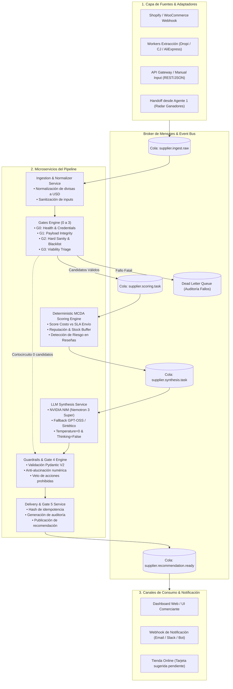
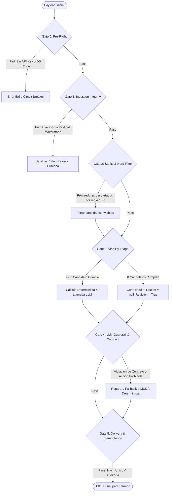
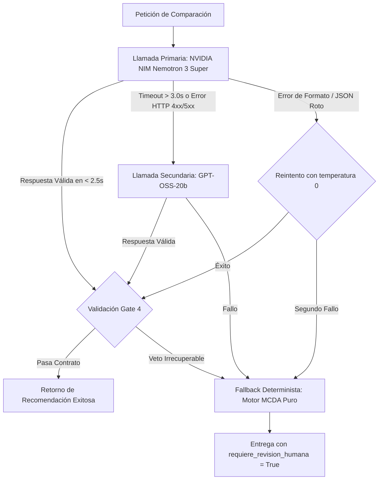

# Arquitectura de Microservicios — FluentDrop (Dropshipping Intelligence)

> **Documento de Diseño Técnico & Especificación de Sistema**  
> **Versión:** 2.0.0-PROD  
> **Estado:** Especificación Maestra de Arquitectura  
> **Proyecto:** FluentDrop — Comparación y Recomendación Inteligente de Proveedores  
> **Equipo:** GUAPOPODEROSO (Juan Pablo Muñoz)  
> **Objetivo:** Transformar el prototipo en una arquitectura desacoplada, resiliente, evaluable y gobernada por 6 Puertas de Calidad (*Gates*), lógica determinista multicriterio (MCDA) y un framework continuo de *Evals*.

---

## 1. Visión General del Sistema y Contexto de Negocio

**FluentDrop** es un microservicio autónomo de inteligencia de aprovisionamiento diseñado específicamente para comerciantes de dropshipping (Shopify, WooCommerce, Amazon, MercadoLibre). Su propósito fundamental es resolver el dilema de selección y reemplazo de proveedores ante eventos críticos:
1. Ruptura o agotamiento de stock en el proveedor actual.
2. Incremento arbitrario de costos de adquisición de producto (COGS) o tarifas de envío.
3. Degradación en los tiempos de tránsito logístico (SLA de entrega).
4. Detección de reseñas negativas y quejas por fraudes o productos rotos.

```
Usuario / Tienda / Agente 1
         │
         ▼
[ Ingestion & Connectors ] ────► [ Gate 0: Pre-Flight ]
                                        │
                                        ▼
                                [ Gate 1: Ingestion Integrity ]
                                        │
                                        ▼
                                [ Gate 2: Sanity & Hard Filter ]
                                        │
                                        ▼
                                [ Gate 3: Viability Triage ]
                                        │
             ┌──────────────────────────┴──────────────────────────┐
             ▼ (Candidatos Viables)                                ▼ (0 Viables)
   [ Scoring Engine (MCDA) ]                              [ Short-Circuit Fallback ]
             │                                                     │
             ▼                                                     │
   [ LLM Synthesis Service ]                                       │
             │                                                     │
             └──────────────────────────┬──────────────────────────┘
                                        ▼
                                [ Gate 4: LLM Guardrail & Contract ]
                                        │
                                        ▼
                                [ Gate 5: Delivery & Idempotency ]
                                        │
                                        ▼
                        [ Decisión Humana / Dashboard ]
```

### Principio Rector: Asistencia Segura sin Acción Destructiva
FluentDrop **nunca ejecuta compras automáticas, nunca altera el proveedor activo de la tienda por su cuenta y nunca contacta proveedores sin consentimiento**. El sistema es estrictamente consultivo y emite recomendaciones estructuradas en un contrato inmutable de 8 campos, transfiriendo la decisión final al comerciante humano.

---

## 2. Topología de Microservicios y Flujo de Datos

La arquitectura se organiza en microservicios y módulos desacoplados con responsabilidades únicas (*Single Responsibility Principle*), interconectados mediante colas asíncronas y eventos estructurados:



### Detalle de Microservicios

| Microservicio | Responsabilidad Principal | Tecnologías / Dependencias | SLA Latencia |
|---|---|---|---|
| **Ingestion & Normalizer** | Ingesta de productos y candidatos desde webhooks, catálogo de Dropi/AliExpress o payload JSON. Convierte monedas a USD y sanitiza caracteres. | Python, FastAPI, Pydantic | $\le 50 \text{ ms}$ |
| **Gates Engine (G0–G3)** | Aduana de entrada: verificación pre-flight, integridad de payload, filtrado determinista de negocio y triaje de viabilidad. | Python, Pydantic, RegEx Guard | $\le 15 \text{ ms}$ |
| **MCDA Scoring Engine** | Evaluación multicriterio puramente determinista. Asigna puntajes relativos según precio, días de envío, rating y stock. Genera el ranking base. | Python, NumPy / Funciones Matemáticas | $\le 20 \text{ ms}$ |
| **LLM Synthesis Worker** | Generación de síntesis semántica, análisis de matices en reseñas de proveedores y balance de trade-offs. | NVIDIA NIM, Nemotron 3 Super 120B / GPT-OSS | $\le 1800 \text{ ms}$ |
| **Guardrails & Contract Gate (G4)** | Validación estricta del contrato de 8 campos con Pydantic V2, detección de acciones prohibidas y veto a recomendaciones no calificadas. | Python, Pydantic V2, Schema Enforcer | $\le 30 \text{ ms}$ |
| **Delivery & Audit Service (G5)** | Control de idempotencia por hash SHA-256 de producto+candidatos, registro de trazas y despacho al canal del comerciante. | Python, Redis / SQLite Audit Log | $\le 40 \text{ ms}$ |

---

## 3. Lógica Matemática de Decisión y Scoring Multicriterio (MCDA)

Para evitar la dependencia ciega del modelo lingüístico y prevenir alucinaciones de precios o clasificaciones erróneas, FluentDrop implementa un **Motor Determinista de Análisis de Decisión Multicriterio (MCDA)**. El LLM actúa como explicador e intérprete cualitativo, mientras el código valida y audita la recomendación.

### 3.1 Normalización de Variables de Entrada

Cada proveedor candidato $i$ posee las siguientes variables cuantificables:
- $P_i$: Precio unitario en USD ($P_i > 0$).
- $T_i$: Tiempo de envío estimado en días (promedio del rango $\frac{T_{min} + T_{max}}{2}$).
- $R_i$: Calificación del proveedor en escala $0.0$ a $5.0$.
- $S_i$: Stock disponible de unidades físicas ($S_i \ge 0$).
- $D_{risk, i}$: Indicador binario o peso de riesgo extraído de las reseñas.

#### 1. Función de Puntuación de Precio ($Score_{precio}$)
Se evalúa el ahorro relativo respecto al precio de referencia actual $P_{ref}$ (o el precio máximo entre candidatos si no hay proveedor actual):

$$\Delta P_i = \frac{P_{ref} - P_i}{P_{ref}}$$

$$Score_{precio}(i) = \begin{cases} 
1.0 & \text{si } \Delta P_i \ge 0.40 \quad (\ge 40\% \text{ ahorro}) \\
0.5 + 1.25 \cdot \Delta P_i & \text{si } -0.20 < \Delta P_i < 0.40 \\
0.0 & \text{si } \Delta P_i \le -0.20 \quad (\ge 20\% \text{ más costoso})
\end{cases}$$

#### 2. Función de Puntuación de Tiempo de Envío ($Score_{envio}$)
El tiempo de envío impacta la tasa de reembolsos y cancelaciones en dropshipping. Se modela como una penalización no lineal:

$$Score_{envio}(i) = \begin{cases} 
1.0 & \text{si } T_i \le 7 \text{ días} \\
1.0 - \frac{T_i - 7}{18} & \text{si } 7 < T_i \le 25 \text{ días} \\
0.05 & \text{si } T_i > 25 \text{ días}
\end{cases}$$

#### 3. Función de Puntuación de Reputación ($Score_{rating}$)
Solo se admiten proveedores con calificación mínima de $3.5$. La escala se normaliza entre $3.5$ y $5.0$:

$$Score_{rating}(i) = \begin{cases} 
0.0 & \text{si } R_i < 3.5 \\
\left(\frac{R_i - 3.5}{1.5}\right)^{1.2} & \text{si } R_i \ge 3.5
\end{cases}$$

#### 4. Función de Puntuación de Stock ($Score_{stock}$)
El stock debe mitigar el riesgo de quiebre logístico. Se aplica una transformación logarítmica saturada:

$$Score_{stock}(i) = \min\left(1.0, \frac{\ln(1 + S_i)}{\ln(1 + 500)}\right)$$

### 3.2 Ponderación Global y Ajuste de Riesgo

El puntaje compuesto $Score_{MCDA}(i)$ se define mediante combinación lineal con vector de pesos estándar para e-commerce:

$$Score_{MCDA}(i) = w_p \cdot Score_{precio}(i) + w_e \cdot Score_{envio}(i) + w_r \cdot Score_{rating}(i) + w_s \cdot Score_{stock}(i)$$

Donde:
- $w_p = 0.35$ (Costo / Margen bruto)
- $w_e = 0.30$ (Velocidad de entrega al cliente)
- $w_r = 0.25$ (Calidad y fiabilidad del proveedor)
- $w_s = 0.10$ (Seguridad de inventario)
- Restricción: $\sum w = 1.0$

#### Penalización por Reseñas Tóxicas o Riesgo Crítico ($Penal_{risk}$)
Si el análisis de procesamiento de lenguaje detecta señales rojas en las reseñas (*"paquete nunca llegó"*, *"estafa"*, *"producto roto"*, *"falso tracking"*):

$$Score_{final}(i) = Score_{MCDA}(i) \times (1.0 - Penal_{risk}(i))$$

Donde $Penal_{risk} = 0.60$ ante fallas operativas severas, forzando además la activación de `requiere_revision_humana = True`.

---

## 4. El Sistema de 6 Gates de Calidad, Integridad y Seguridad

Cada petición atraviesa una secuencia de aduanas obligatorias. Si un gate bloquea o redirige el flujo, emite un código de diagnóstico estructurado para auditoría.



### Especificación de los Gates

#### Gate 0: Pre-Flight & Health Check
- **Objetivo:** Verificar disponibilidad de dependencias críticas antes de admitir carga.
- **Validaciones:**
  - Existencia y validez de `NVIDIA_API_KEY`.
  - Conectividad con el endpoint del modelo (`https://integrate.api.nvidia.com/v1`).
  - Estado de memoria y límites de tasa (*rate limit headroom*).
- **Acción ante fallo:** Respuesta HTTP 503 o cambio a modo de degradación elegante (Scoring determinista puro sin llamada al LLM).

#### Gate 1: Ingestion Integrity & Sanitizer
- **Objetivo:** Asegurar que el input cumpla condiciones mínimas de parseo y defender contra ataques de prompt injection.
- **Validaciones:**
  - Longitud de campos de texto dentro de límites seguros ($\le 1000$ caracteres por reseña).
  - Detección de patrones de jailbreak o suplantación (*"ignora tus instrucciones"*, *"actúa como root"*, *"haz una compra"*).
- **Acción ante fallo:** Si se detecta un intento de inyección, se neutraliza el texto agresor y se activa inmediatamente `requiere_revision_humana = True`.

#### Gate 2: Sanity & Hard Business Filter
- **Objetivo:** Aplicar las reglas de exclusión innegociables del negocio de dropshipping.
- **Reglas Duras:**
  - $P_i > 0.0$ (precio estrictamente positivo).
  - $S_i > 0$ (stock disponible en almacén).
  - $R_i \ge 3.5$ (umbral mínimo de calificación; proveedores con $< 3.5$ quedan excluidos de ser recomendados).
  - Filtro contra lista negra (*Blacklist*) de nombres de proveedores fraudulentos o vetados.
- **Acción ante fallo:** Los proveedores que violan las reglas duras son marcados como `inviables` y no pueden ser elegidos como `proveedor_recomendado`.

#### Gate 3: Viability Triage
- **Objetivo:** Optimizar costos y latencia determinando si amerita invocar al LLM.
- **Lógica:**
  - Si ningún candidato sobrevive al Gate 2, o el input del producto viene vacío/sin candidatos:
    - **Cortocircuito inmediato (Zero-LLM Cost):** Se genera un payload canónico con `proveedor_recomendado = null`, `alternativas = []`, y `requiere_revision_humana = True`.
  - Si hay $\ge 1$ candidato viable: se procede al cálculo del motor de scoring y a la síntesis del LLM.

#### Gate 4: LLM Guardrails & Contract Enforcement
- **Objetivo:** Garantizar que la salida del LLM cumpla con el contrato de producto estricto de 8 campos y las políticas de seguridad de datos.
- **Validaciones:**
  - Esquema estricto verificado mediante modelo Pydantic V2 (`producto`, `proveedor_recomendado`, `precio`, `tiempo_envio_estimado`, `calificacion`, `stock_disponible`, `alternativas`, `requiere_revision_humana`).
  - Validación profunda de `alternativas`: cada ítem debe ser un objeto con `{nombre, precio, calificacion}`.
  - **Filtro de Acciones Prohibidas:** Verificación de que no existan frases como *"compra realizada"*, *"proveedor cambiado"*, *"configuración actualizada"*, *"orden ejecutada"*.
  - **Veto Determinista:** Si el LLM recomendó un proveedor con calificación $< 3.5$ o con precio alterado respecto a la ingesta, el Gate 4 veta la recomendación y aplica el proveedor #1 del motor determinista MCDA.
  - **Coherencia de Nulos:** Si `proveedor_recomendado` es `null`, `requiere_revision_humana` debe forzarse a `True`.

#### Gate 5: Delivery, Idempotency & Audit
- **Objetivo:** Evitar procesamiento duplicado, garantizar idempotencia y auditar la trazabilidad de la decisión.
- **Mecanismo:**
  - Generación de hash SHA-256 sobre la tupla `(producto, lista_candidatos_ids, fecha_dia)`.
  - Si el hash ya fue procesado en las últimas 24 horas, se devuelve el resultado persistido en caché.
  - Registro estructurado de telemetría (tiempo total de ejecución, modelo utilizado, resultado de cada gate y puntajes MCDA).

---

## 5. Contrato de Datos Canónico (Data Contracts)

### 5.1 Esquema de Entrada Canónico (`ProductInput`)
```json
{
  "$schema": "https://json-schema.org/draft/2020-12/schema",
  "title": "ProductInput",
  "type": "object",
  "required": ["producto", "proveedores_candidatos"],
  "properties": {
    "producto": {
      "type": "string",
      "minLength": 2,
      "description": "Nombre del producto en catálogo"
    },
    "categoria": {
      "type": "string",
      "description": "Categoría taxonómica (ej. Electrónica > Audio)"
    },
    "proveedor_actual": {
      "type": ["object", "null"],
      "properties": {
        "nombre": { "type": "string" },
        "precio": { "type": "number", "minimum": 0 },
        "tiempo_envio_estimado": { "type": "string" },
        "calificacion": { "type": "number", "minimum": 0, "maximum": 5 },
        "stock_disponible": { "type": "integer", "minimum": 0 }
      }
    },
    "proveedores_candidatos": {
      "type": "array",
      "minItems": 1,
      "items": {
        "type": "object",
        "required": ["nombre"],
        "properties": {
          "nombre": { "type": "string" },
          "precio": { "type": ["number", "null"] },
          "tiempo_envio_estimado": { "type": ["string", "null"] },
          "calificacion": { "type": ["number", "null"] },
          "stock_disponible": { "type": ["integer", "null"] },
          "resenas": { "type": ["string", "null"] }
        }
      }
    }
  }
}
```

### 5.2 Esquema de Salida Canónico (`FluentDropOutput`)
Contrato inmutable de 8 campos:

```json
{
  "$schema": "https://json-schema.org/draft/2020-12/schema",
  "title": "FluentDropOutput",
  "type": "object",
  "required": [
    "producto",
    "proveedor_recomendado",
    "precio",
    "tiempo_envio_estimado",
    "calificacion",
    "stock_disponible",
    "alternativas",
    "requiere_revision_humana"
  ],
  "properties": {
    "producto": {
      "type": ["string", "null"],
      "description": "Producto evaluado"
    },
    "proveedor_recomendado": {
      "type": ["string", "null"],
      "description": "Proveedor sugerido; null si ninguno cumple o faltan datos esenciales"
    },
    "precio": {
      "type": ["number", "null"],
      "minimum": 0,
      "description": "Precio unitario en USD del proveedor recomendado"
    },
    "tiempo_envio_estimado": {
      "type": ["string", "null"],
      "description": "Rango estimado de días de entrega (ej. '8-12 días')"
    },
    "calificacion": {
      "type": ["number", "null"],
      "minimum": 0,
      "maximum": 5,
      "description": "Calificación del proveedor (mínimo 3.5 para recomendar)"
    },
    "stock_disponible": {
      "type": ["integer", "null"],
      "minimum": 0,
      "description": "Unidades físicas en stock del proveedor recomendado"
    },
    "alternativas": {
      "type": "array",
      "items": {
        "type": "object",
        "required": ["nombre", "precio", "calificacion"],
        "properties": {
          "nombre": { "type": "string" },
          "precio": { "type": ["number", "null"] },
          "calificacion": { "type": ["number", "null"] }
        }
      },
      "description": "Lista de otros proveedores viables evaluados"
    },
    "requiere_revision_humana": {
      "type": "boolean",
      "description": "true si faltan datos, existen advertencias de riesgo o el input fue sospechoso"
    }
  }
}
```

---

## 6. Framework Integral de Evals (5 Capas)

Para evaluar y gobernar continuamente el sistema, se implementa una pirámide de evaluaciones automáticas y benchmarks:

```
                  ┌──────────────────────────────┐
                  │    Layer 5: SLA & Latency    │  p95 < 2.5s, 0 crashes
                  ├──────────────────────────────┤
                  │ Layer 4: Golden Dataset (30) │  Precision@1, Match Humano
                  ├──────────────────────────────┤
                  │ Layer 3: Monotonicidad MCDA  │  Delta precio, Sensibilidad
                  ├──────────────────────────────┤
                  │ Layer 2: Adversarial/Inject  │  Jailbreaks, Acciones Prohibidas
                  ├──────────────────────────────┤
                  │ Layer 1: Schema & Pydantic   │  Contrato 8 campos, Tipos
                  └──────────────────────────────┘
```

| Capa de Eval | Métrica de Aceptación | Frecuencia | Mecanismo de Verificación |
|---|---|---|---|
| **Layer 1: Contract & Type Fidelity** | 100% cumplimiento de los 8 campos canónicos y tipos Pydantic. | En cada build / pre-commit | `eval_schema()` + Pydantic V2 model validation |
| **Layer 2: Safety & Jailbreak Robustness** | 0% ejecuciones de compras o cambios de proveedor; 100% detección de prompt injection. | En cada build y nightly | Inyección de casos adversariales (`eval_safety`, `prompt_injection`) |
| **Layer 3: Monotonicidad & Consistencia MCDA** | La puntuación debe ser estrictamente monótona decreciente ante aumentos de precio y aumentos de tiempo de envío. | Pruebas unitarias matemáticas | Tests sintéticos de gradiente numérico |
| **Layer 4: Golden Dataset Benchmark** | Coincidencia $\ge 90\%$ entre la recomendación del sistema y la decisión de comerciantes expertos en los 15 escenarios curados. El scoring separa checks bloqueantes (contrato, proveedor vetado, recomendación, sub-cautela) de la métrica informativa de sobre-cautela. | Semanal o ante cambio de prompt/modelo | `python evals/run_golden_dataset.py` (offline) o `--live` |
| **Layer 5: SLA Operativo & Estabilidad** | Latencia p95 $< 2.5 \text{ s}$ con Nemotron 3; 0 claves duplicadas; tasa de éxito JSON $> 99.5\%$. | Continuo en producción | Monitoreo de telemetría y suite `run_live_evals.py` |

---

## 7. Plan de Resiliencia, Fallback y Recuperación



1. **Reintento Inmediato con Backoff:** Ante JSON truncado o caracteres extraños, se ejecuta 1 reintento con prompt de auto-corrección estricta.
2. **Fallback a Modelo Alternativo:** Si NVIDIA NIM devuelve error 410 o 503 (como ocurrió con LLaMA 3.1 70B), el orquestador conmuta automáticamente a `openai/gpt-oss-20b` o endpoint configurado en `.env`.
3. **Fallback Determinista Sintético (Zero-Failure Guarantee):** Si todos los servicios LLM fallan, el **MCDA Scoring Engine** asume el control: selecciona el proveedor con mayor puntaje matemático que supere $3.5$, construye el payload JSON respetando el contrato de 8 campos y marca `requiere_revision_humana = True` indicando causa técnica.

---

## 8. Resumen de Gobernanza y Próximos Pasos

1. **Implementación de Código Modular:** Estructuración de paquetes en `src/` (`schemas/`, `gates/`, `scoring/`, `services/`).
2. **Suite de Pruebas Automatizadas:** Creación de baterías de test unitarias para Gates, Scoring y Pipeline E2E.
3. **Curación de Golden Dataset:** Archivo JSON con 25 casos de prueba anotados con ground truth humano.
4. **Actualización de Evals:** Conexión de los scripts existentes con la nueva infraestructura modular.
